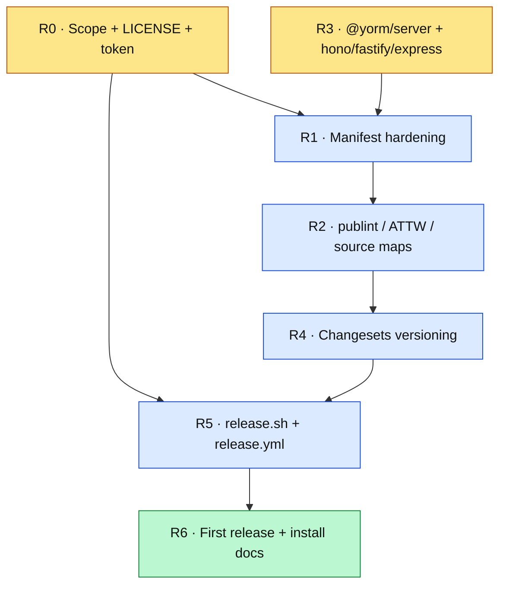

# YORM npm release plan

> **Status (2026-08-22): proposed.** Nothing is published. The five `@yorm/*`
> packages are already publish-_shaped_ (`files: ["dist"]`, `exports`, `types`,
> version `0.1.0`, no `private`), but the `@yorm` scope does not exist on
> npmjs.org (`npm view @yorm/core` → 404), there is no LICENSE anywhere in the
> repo, no package carries `license`/`repository`/`description`, and
> [.github/workflows/ci.yml](.github/workflows/ci.yml) is the only workflow.
> This plan takes the workspace from "builds locally" to "installable from
> npm with provenance".

## Deliverables

- A claimed npm scope with a CI automation token, and a repository LICENSE.
- **The final package set**, so the first publish does not have to be walked
  back: `@yorm/core`, `@yorm/yjs`, `@yorm/drizzle`, `@yorm/fhir`, plus a
  framework-neutral `@yorm/server` and the thin `@yorm/hono`, `@yorm/fastify`,
  and `@yorm/express` adapters.
- Complete, lint-clean manifests for every publishable package.
- Tarballs that are correct for consumers: working types, working source maps,
  no stale `dist`.
- Changesets-driven versioning with a changelog per package.
- A `scripts/release.sh` that a developer can run locally, wrapped by a thin
  `release.yml` workflow (script-first, per
  [.github/copilot-instructions.md](.github/copilot-instructions.md)).
- Install instructions in [README.md](README.md) and
  [docs/ARCHITECTURE.md](docs/ARCHITECTURE.md).

## Guiding constraints

- **Publish only `packages/*`.** Both `examples/*` are already `private: true`,
  so `pnpm -r publish` skips them; keep it that way.
- **Settle the package surface before the first publish.** Splitting
  `@yorm/hono` into a core plus adapters _after_ 0.1.0 is on npm is a breaking
  change for the very first consumers, so R3 lands before R6.
- **`workspace:*` stays in source.** `pnpm publish` rewrites the protocol to the
  concrete version at pack time — do not hand-maintain version ranges.
- **Build before pack, always.** `dist` is gitignored, so a publish from a dirty
  or unbuilt tree silently ships whatever happens to be on disk.
- **Script-first.** Every release step must be runnable locally with the same
  command CI uses.
- **Smallest viable change per milestone**; each is independently mergeable.

## Milestones

### R0 — Identity, license, credentials (human-only; blocks everything)

- [ ] Claim `@yorm` on npmjs.org as an org (Decision #1). **Human-only.**
- [x] Decide the license (Decision #2: MIT); add a root [LICENSE](LICENSE) file.
- [ ] Create a **granular access token** scoped to the org, store it as the
      `NPM_TOKEN` repository secret. **Human-only.**
- [x] Confirm `github.com/mieweb/yorm` is public (npm provenance requires a
      public repo and a public package).

**Exit criteria:** `npm org ls <scope>` succeeds locally; `LICENSE` is committed;
the `NPM_TOKEN` secret exists.

### R1 — Manifest hardening

For each of the five `packages/*/package.json`:

- [x] `"license"`, `"description"`, `"keywords"`, `"author"`.
- [x] `"repository": { "type": "git", "url": "git+https://github.com/mieweb/yorm.git", "directory": "packages/<name>" }`
      — the `directory` field is what makes npm's "Repository" link and
      provenance attestation point at the right subfolder.
- [x] `"homepage"`, `"bugs"`.
- [x] `"publishConfig": { "access": "public", "provenance": true }` — scoped
      packages default to `restricted`, so this is required, not cosmetic.
- [x] `"sideEffects": false` (all five are pure ESM libraries).
- [x] `"engines": { "node": ">=20" }`, mirroring the root manifest.

**Exit criteria:** `npm pack --dry-run` in each package shows `README.md`,
`LICENSE`, and `dist/**` and nothing else; no `npm notice` warnings.

> **Verified with `pnpm pack`, not `npm pack`.** The root `LICENSE` is not inside
> any package directory, so `npm pack` omits it; `pnpm pack`/`pnpm publish` copy
> the workspace-root `LICENSE` into every tarball. Since `pnpm -r publish` is the
> only sanctioned publish path (R5), one root license file stays the single
> source of truth instead of five copies.

### R2 — Tarball correctness

- [x] **Fix source maps.** `npm pack --dry-run` on `@yorm/core` used to ship
      `dist/**/*.js.map` and `dist/**/*.d.ts.map` but **no sources**, so every
      map was dangling. Fixed per Decision #5 by adding `"src"` to `files` in
      all five manifests — `tsc` emits `sources: ["../src/…"]`, which resolves
      exactly when `dist` and `src` are siblings in the tarball.
- [x] Added `publint` + `@arethetypeswrong/cli` as root devDependencies and a
      `pnpm run check:packages` script that runs both over every package.
- [~] Stale-`dist` guard — Decision #6 puts it in `scripts/release.sh`, so the
  checkbox lands with R5.
- [x] Wired `check:packages` into the root `ci` script so regressions fail PRs
      (`.github/workflows/ci.yml` already runs `pnpm run ci`, so no workflow
      change was needed).

**Exit criteria:** `pnpm run check:packages` is green; a tarball installed into
a scratch project resolves types and `import`s correctly.

> **Verified 2026-08-22.** `pnpm run check:packages` exits 0 (publint "All
> good!" ×5; attw all-green under `--profile esm-only`, which is the right
> profile for pure-ESM packages — the only finding was the expected
> `CJSResolvesToESM`). A scratch ESM project installing the `core`/`yjs`/`fhir`
> tarballs typechecks under `moduleResolution: NodeNext` and imports at runtime,
> and all 10 shipped `@yorm/core` maps resolve to real sources.

### R3 — Transport adapters: freeze the published surface

An audit of [packages/hono](packages/hono) on 2026-08-22 (1142 source lines)
found it is already **~79% framework-neutral**: 238 lines touch Hono, the rest
is session caching, y-protocols sync/awareness, room and policy-lens
management, and document/proposal business logic. The Hono surface is narrow —
route registration, `c.req.param/query/json/header`, `c.json()`, and the
`WSContext` `send`/`close` pair — and the `upgradeWebSocket` injection seam is
already the right abstraction. This milestone is the design in
[YOTA-plan.md](YOTA-plan.md) Y4a/Y4b, pulled forward (that plan lists it as an
open question precisely because it only refactors shipped code) and extended
with Express.

#### R3a. `@yorm/server` — framework-neutral core

- [ ] Define the minimal request abstraction: `method`, `path`, `param(name)`,
      `query(name)`, `header(name)`, `json()`, and **`rawBody()`** — raw body is
      part of the contract from day one so YOTA webhook signature verification
      is possible without another breaking change.
- [ ] Define the minimal socket abstraction: `send(Uint8Array)`,
      `close(code, reason)`, and identity comparison (room fan-out skips the
      origin socket by reference).
- [ ] Move `packages/hono/src/shared.ts` essentially unchanged (session cache,
      `openSession`, `attachMaxLagFlush`, `parsePolicy`, `policyFromQuery`).
- [ ] Move the room registry, y-protocols sync/awareness handling, the policy
      lens wiring, and `guardCanonicalWrites` unchanged.
- [ ] Re-type `onAuthorize`/`onAuthorizeWrite` against the neutral request
      (Decision #7).

#### R3b. Transport conformance suite

- [ ] Generalize [packages/hono/test/miniClient.ts](packages/hono/test/miniClient.ts)
      into a reusable y-protocols client — this is the third shared suite,
      after `adapterConformanceTests` and the (proposed) connector suite.
- [ ] Suite contents: document CRUD over HTTP, `onAuthorize`/`onAuthorizeWrite`
      refusals (403 / close 1008), two WebSocket clients converge, proposer-mode
      canonical-write guard, and role-lens redaction.
- [ ] Each adapter supplies a `start()`/`stop()` harness returning a base URL;
      WebSocket coverage needs a real Node listener on an ephemeral port, so the
      suite cannot rely on Hono's in-process `app.request()`.

#### R3c. Adapters

- [ ] `@yorm/hono` — refactor in place into a thin adapter. The existing
      `http.test.ts` / `websocket.test.ts` / `websocket-policy.test.ts` are the
      regression suite: behavior must not change.
- [ ] `@yorm/fastify` — `fastify-plugin` + `@fastify/websocket`; raw body via
      `addContentTypeParser`.
- [ ] `@yorm/express` — Express 5, WebSocket upgrade handled by the raw `ws`
      package attached to the underlying `http.Server` (Decision #8); raw body
      via `express.json({ verify })`.
- [ ] Update [examples/patient-collab-demo/src/server.ts](examples/patient-collab-demo/src/server.ts)
      — it is the only in-repo consumer of the hook signature, using
      `c.req.header("x-demo-mode")` and `c.req.query("mode")`, both of which the
      neutral request covers directly.

**Exit criteria:** the shared transport suite is green on all three adapters;
the demo server runs unchanged in behavior; `@yorm/hono`'s pre-refactor tests
still pass.

### R4 — Versioning with Changesets

- [ ] Add `@changesets/cli`; `pnpm changeset init`.
- [ ] Configure `.changeset/config.json`: `"access": "public"`,
      `"baseBranch": "main"`, ignore both `examples/*` packages.
- [ ] Choose fixed vs. independent versioning (Decision #3) and encode it in
      the `fixed`/`linked` arrays.
- [ ] Document the "add a changeset with your PR" rule in the contributing
      section of [README.md](README.md).

**Exit criteria:** `pnpm changeset` → `pnpm changeset version` produces the
expected bumps and `CHANGELOG.md` files in a throwaway branch.

### R5 — Release automation

- [ ] `scripts/release.sh`: `pnpm install --frozen-lockfile` → `pnpm run ci` →
      `pnpm run check:packages` → `pnpm -r publish --access public --no-git-checks`
      (pnpm publishes in topological order, so `@yorm/core` lands before its
      dependents automatically).
- [ ] `.github/workflows/release.yml`: a thin wrapper calling that script, with
      `permissions: { id-token: write, contents: write }` for provenance,
      `NODE_AUTH_TOKEN` from the secret, and the same submodule/vendor build
      steps `ci.yml` already performs.
- [ ] Add the Changesets "Version Packages" PR step so releases are a merge, not
      a manual tag.
- [ ] Dry-run the whole thing against `--dry-run` before the first real publish.

**Exit criteria:** a dry-run workflow run completes and lists the five intended
tarballs.

### R6 — First release and docs

- [ ] Decide the first published version (Decision #4).
- [ ] Publish; verify `npm view @yorm/core` and the provenance badge on npmjs.
- [ ] Add an **Install** section to [README.md](README.md) with real
      `pnpm add` lines and the peer-dependency matrix (`yjs ^13`, `hono ^4`,
      `fastify ^5`, `express ^5`, `better-sqlite3 >=11`).
- [ ] Update [docs/ARCHITECTURE.md](docs/ARCHITECTURE.md) to state that
      `packages/*` are published and how the release flow works.
- [ ] Smoke-test: fresh directory, install from npm, run the quickstart.

**Exit criteria:** a clean machine can `pnpm add @yorm/core @yorm/yjs` and run
the README quickstart without the monorepo checked out.

## Build order

R3 gates R1 only in the sense that the new packages need manifests too — the
extraction itself is independent of R0 and can start immediately.

## Decisions

1. **Scope name — DECIDED (2026-08-22): `@yorm`.** It is unclaimed on npmjs.org,
   matches every import in the docs, and avoids renaming ~1300 lines of README
   examples plus every import across the monorepo and the demo. The alternative
   (`@mieweb/yorm-*`, reusing the org that already publishes `@mieweb/ui`) was
   rejected because the rename cost is real and buys only one fewer org to own.
2. **License — DECIDED (2026-08-22): MIT**, the mieweb open-source default.
   Root [LICENSE](LICENSE) is the single copy; `pnpm publish` copies it into
   every tarball, and each manifest declares `"license": "MIT"`.
3. **Fixed vs. independent versioning — OPEN (2026-08-22).** The five packages
   are tightly coupled (`@yorm/fhir` and `@yorm/hono` both depend on `core` +
   `yjs`) and all sit at `0.1.0`. **Recommendation: `fixed`** while pre-1.0 —
   one version number for the whole surface is far easier to document, and
   Changesets can be switched to independent later.
4. **First published version — OPEN (2026-08-22).** Options: publish `0.1.0` as
   is, or bump to `0.2.0` to signal that the published artifact differs from the
   long-lived in-repo `0.1.0`. **Recommendation: `0.1.0`** — nothing consumed it
   yet, so there is no version to disambiguate from.
5. **Source maps — DECIDED (2026-08-22): ship `src`.** These are small pure-TS
   packages, so working step-through debugging for consumers is worth roughly
   doubling the tarball. `files: ["dist", "src"]`; `include: ["src"]` in each
   `tsconfig.json` keeps `test/` out of the tarball.
6. **Stale-`dist` guard — DECIDED (2026-08-22): guard in `scripts/release.sh`.**
   `prepack` runs per package and would rebuild five times; `release.yml` is the
   only sanctioned publish path, so a single guard in the script it calls is
   cheaper and sufficient.
7. **Auth hook signature — OPEN (2026-08-22).** `onAuthorize`/`onAuthorizeWrite`
   currently receive Hono's `Context`, which cannot survive the split. Options:
   (a) pass the neutral request to every adapter, or (b) let each adapter pass
   its own native context through a generic. **Recommendation: (a)** — the only
   in-repo consumer needs just `header()` and `query()`, and a neutral hook
   means an authorization rule written once works on all three frameworks. This
   is a breaking change to `@yorm/hono`'s current API, which is exactly why it
   must happen before the first publish.
8. **Express flavor — DECIDED (2026-08-22): Express 5 with the raw `ws`
   package** attached to the underlying `http.Server`, rather than `express-ws`.
   Express has no native WebSocket support; `express-ws` is a thin, sparsely
   maintained wrapper over the same `ws` library, and going direct keeps the
   upgrade path explicit and dependency-light.

## Out of scope

- Publishing either `examples/*` package — both stay `private: true`.
- Publishing anything from `vendor/` (`@mieweb/ui`, `@esheet/*`, chimeraDB);
  those are upstream repos with their own release processes. See
  [.github/skills/unreleased-dependency/SKILL.md](.github/skills/unreleased-dependency/SKILL.md)
  for how the demo consumes them unreleased.
- `@yorm/wormhole` (Meteor 3 via the meteor-wormhole plugin host). It is the
  fourth adapter in [YOTA-plan.md](YOTA-plan.md) Y4b, but it does not change the
  shape of `@yorm/server`, so it can ship after 0.1.0 without churning the
  published surface.
- The YOTA-specific routes that also live in `@yorm/server` (`submit`,
  `submission-state`, `POST /webhooks/:connector`) — those stay in
  [YOTA-plan.md](YOTA-plan.md) Y4a. R3 only guarantees the raw-body seam exists
  so they can be added without a breaking change.
- Deprecating or unpublishing anything — nothing is published yet.
- The public sandbox deployment on port 3000, which is unrelated to npm
  distribution (see [deploy/README.md](deploy/README.md)).
